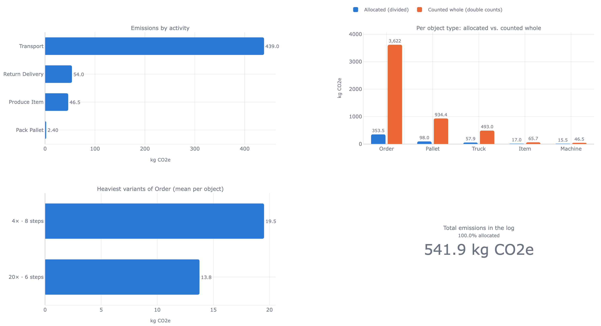
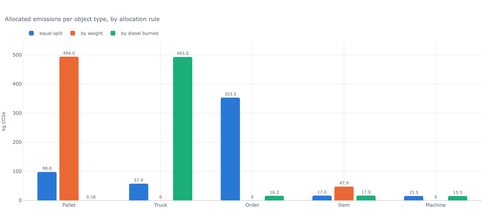

# Carbon Footprint — an Ocelescope plugin

Carbon accounting for object-centric event logs: compute what each event emits,
then divide those emissions among the objects the event involves.

Built for [Ocelescope](https://www.ocelescope.org), the object-centric process
mining framework. Drop the `.zip` into a running instance and the three methods
appear with their forms generated from the Python signatures.



## Why allocation is the interesting part

An event in an object-centric log belongs to no single case. One transport event
relates to a truck, two pallets, every order on board and the items inside them.
Its emissions have no owner — only a set of candidates and a choice of how to
divide one number among them.

This plugin always **divides**, never copies. The shares of one event sum back to
that event's emissions, so a total per object type is a real total. The number you
get from *not* dividing — flattening the log to one object type and summing the
cases, where an event shared by k objects is counted k times — is reported
alongside it, so the double counting is visible instead of inherited:

On the **Container Logistics** log that ships with Ocelescope (36k events,
7 object types, illustrative factors):

| Object type | Allocated | Flattened reading | Overstated by |
|---|---:|---:|---:|
| Container | 13 680 | 40 748 | 3.0× |
| Handling Unit | 11 784 | 34 297 | 2.9× |
| Truck | 11 306 | 33 869 | 3.0× |
| Forklift | 2 247 | 6 580 | 2.9× |
| Vehicle | 2 103 | 6 304 | 3.0× |
| Customer Order | 45 | 60 | 1.3× |
| Transport Document | 39 | 129 | 3.3× |
| **Total** | **41 203** | **121 987** | |

The allocated column sums to the log's emissions exactly. The flattened column
sums to three times them — the same kilograms counted once per object type that
touched them.

Emissions that genuinely cannot be allocated — an event whose eligible objects
were all excluded, say — are reported as `unallocated_co2e` rather than dropped or
spread over the rest. `allocated + unallocated == total` is asserted in the tests.

## The three methods

### 1. Inspect log

No configuration. Lists every activity with the numeric event attributes, the
quantity item types and the object types it offers, plus a suggested basis, so
factors can be written against something the log actually carries.

### 2. Compute footprint

Takes emission factors and an allocation rule. Returns:

- **the annotated log** — a copy carrying `carbon:event_co2e` on events and
  `carbon:allocated_co2e` on objects, as ordinary OCEL attributes, so it can be
  filtered, charted or fed to the next plugin;
- **Carbon Footprint** — totals, per activity, per object type (allocated and
  flattened), per process variant, plus coverage diagnostics;
- **Carbon Hotspots** — the individual objects carrying the most, as a table.

### 3. Compare allocation rules

Applies several rules to one and the same set of event emissions, so every
difference in the chart is the modelling choice and nothing else. It reports a
`spread` per object type: the largest share any rule gives it over the smallest.



The same 541.9 kg of the example log: pallets carry 494 kg when emissions follow
mass and 98 kg when they are split evenly, while trucks carry 493 kg when
emissions follow the diesel burned and 58 kg when they are not. Nothing about the
log or the factors changed between those bars.

## Emission factors

A factor is a rule for one activity. Several rules may name the same activity and
their contributions add up, so a transport activity can carry a fixed handling
emission plus a per-kilometre one.

| Basis | The factor is multiplied by | Use when |
|---|---|---|
| `per_event` | 1 per occurrence | a flat estimate per activity |
| `per_event_attribute` | a numeric event attribute | the log records a distance, a mass, an energy reading |
| `per_item_quantity` | the quantity of one item type the event moves | the log carries the quantity extension |

`per_item_quantity` reads the **quantity extension** (QEL): the `qel:quantity`
operations an event makes on an object's item level. Because an operation is
signed — a change, not a level — `quantity_measure` says how to read it:
`absolute`, `increase`, `decrease` or `signed`. Fuel drawn from a tank is a
decrease; counting it as `decrease` turns the recorded material flow itself into
the emission figure, rather than an estimate attached to the event.

Activities no factor names are charged `default_factor` (zero by default) and are
listed in the report's diagnostics either way, so a total is never quietly built
on half a log.

## Allocation rules

| Rule | Share proportional to | Note |
|---|---|---|
| `equal` | nothing — an even split | the default |
| `object_attribute` | a numeric object attribute | mass, volume, value |
| `item_quantity` | the quantity of one item type the event moves for that object | follows the material flow |

All three accept `object_types` and `qualifiers` to restrict which objects are
eligible at all, and `on_zero_weight` to decide what happens to an event whose
eligible objects all weigh zero: split it equally among them, or leave it
unallocated and report it.

An object related twice to one event under different qualifiers is one target, not
two.

## Install

Download `CarbonFootprintPlugin.zip` from the releases, or build it:

```bash
pip install ocelescope
ocelescope build        # writes dist/CarbonFootprintPlugin.zip
```

Start Ocelescope and upload the zip in the app:

```bash
curl -LO https://www.ocelescope.org/docker-compose.yaml
docker compose up -d    # the UI is on http://localhost:3000
```

If port 3000 is taken, change the frontend's port mapping in the compose file.

## Try it on the example log

The repository ships a small logistics log with the quantity extension
(`examples/sample_logistics_qel.jsonocel`, 125 events, 82 objects): orders,
items, pallets, trucks and machines, with fuel and electricity recorded as
quantity operations, a `distance_km` event attribute and a `weight_kg` object
attribute — one of each thing a factor or an allocation rule can use.

Upload it alongside the plugin, then run **Compute footprint** with:

| Activity | Basis | Factor | Item type | Measure |
|---|---|---|---|---|
| Transport | `per_item_quantity` | 2.68 | `diesel_l` | `decrease` |
| Return Delivery | `per_item_quantity` | 2.68 | `diesel_l` | `decrease` |
| Produce Item | `per_item_quantity` | 0.38 | `electricity_kwh` | `decrease` |
| Pack Pallet | `per_event` | 0.4 | | |

and `Order` as the variant object type. 541.9 kg CO₂e over 125 events, of which
the failed-delivery variants cost the most per order.

To regenerate the log, or to render the figures without Ocelescope:

```bash
python examples/generate_sample_log.py      # writes the .jsonocel
python examples/render_demo.py              # writes demo_*.html
```

## Development

```bash
pip install -e ".[dev]"
pytest                  # 49 tests, 1 skipped (see below)
ocelescope build
```

The modules are usable without Ocelescope running: `compute_event_emissions`,
`allocate_emissions` and `naive_per_object_type` take an `ocelescope.OCEL` and
return pandas objects, which is what the tests work against. `src/ocel_carbon`
uses relative imports only, as the plugin builder requires.

### Known upstream issue

`ocelescope` 0.13.0 reads and writes OCEL *files* through
`r4pm.bindings.stream_ocel_to_duckdb` and `read_consolidated_ocel_from_duckdb`,
which the released `r4pm-full` 0.7.1 no longer provides, so `OCEL.read` and
`OCEL.write` raise `AttributeError` with those two versions installed together.
The Ocelescope backend image is unaffected — it imports and exports logs fine.
The plugin never touches files, so this only costs one skipped test; the example
log is written by a small OCEL 2.0 JSON writer in `examples/sample_log.py` rather
than by `OCEL.write`.

## Limitations

- Emissions are attributional, not consequential: factors are applied to recorded
  activity and nothing is modelled about what would have happened otherwise.
- `object_attribute` weights use static object attributes. An attribute whose
  value changes over the object's life is read as its static value.
- Nothing is converted between units. `unit` is a label; the factors must already
  agree with each other.
- The variant breakdown is per object type, over the activity sequences of that
  type's objects.

## License

MIT — see [LICENSE](LICENSE).
